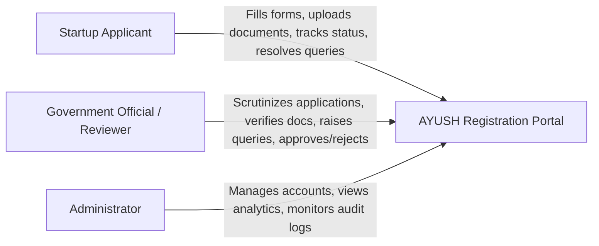
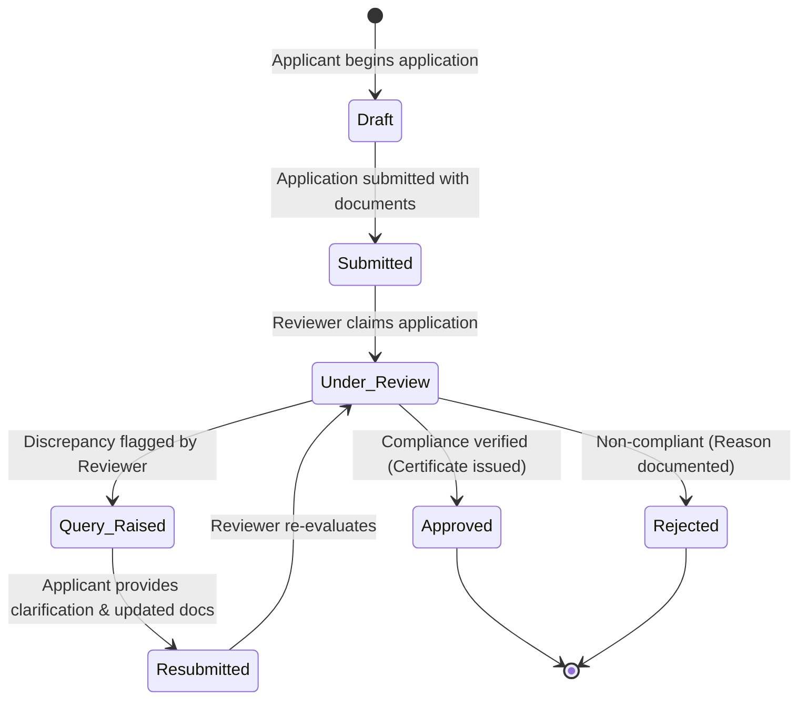

# AYUSH Startup Registration Portal

A comprehensive digital platform designed to streamline, digitize, and standardize the registration process for startups operating across the AYUSH sector (**A**yurveda, **Y**oga & Naturopathy, **U**nani, **S**iddha, and **H**omoeopathy).

Developed as part of the **Advanced Software Development (ASD)** and **Database Management Systems (DBMS)** curriculum, this portal addresses existing inefficiencies in traditional registration processes by enhancing transparency, accelerating regulatory reviews, and securing sensitive compliance documentation.

---

## 🏛️ Project Background & Problem Statement

* **Domain / Category**: MedTech / BioTech / HealthTech (Software)
* **Initiating Organization**: Ministry of AYUSH
* **Department**: All India Institute of Ayurveda (AIIA)

The AYUSH sector is experiencing rapid entrepreneurial growth with innovative formulations, wellness products, and digital healthcare solutions. However, startups often encounter challenges in navigating opaque, decentralized, and manual registration processes. 

The **AYUSH Startup Registration Portal** solves this by offering a centralized single-window system that connects **Startup Applicants**, **Government Officials / Reviewers**, and **System Administrators** in a transparent, accountable, and secure workflow.

---

## 📋 Project Documentation

All Phase 1 and Phase 2 requirement analysis, workflows, technical architectural specifications, and database designs are maintained in the [`docs/`](./docs) directory (see [`docs/README.md`](./docs/README.md) for index):

Database setup and migration instructions are in [`database/README.md`](./database/README.md). The Prisma schema and migration history live in `backend/prisma/`; commit these migration files so teammates and deployments can reproduce the PostgreSQL schema. Keep `.env` files and database credentials out of Git.

### Phase 1: Requirements & Architecture
| Document | Description |
| :--- | :--- |
| **[`docs/requirements.md`](./docs/requirements.md)** | Problem statement, functional requirements (FR-1 to FR-7), non-functional requirements (security, usability, scalability, reliability), and MVP boundaries. |
| **[`docs/user-roles.md`](./docs/user-roles.md)** | Detailed role specifications (*Startup Applicant*, *Government Reviewer*, *Administrator*), Role-Based Access Control (RBAC) matrix, and Mermaid Use-Case diagram. |
| **[`docs/application-workflow.md`](./docs/application-workflow.md)** | Complete end-to-end registration lifecycle, state transition machine (`Draft` $\rightarrow$ `Submitted` $\rightarrow$ `Under Review` $\rightarrow$ `Clarification Required` $\rightarrow$ `Resubmitted` $\rightarrow$ `Approved` / `Rejected`), and workflow flowchart. |
| **[`docs/tech-stack.md`](./docs/tech-stack.md)** | Selected technologies (React 19, Vite, Tailwind CSS v4, Node.js/Express, PostgreSQL, Prisma ORM) and their architectural justifications. |
| **[`docs/application-workflow.md`](./docs/application-workflow.md)** | Complete end-to-end registration lifecycle, state transition machine (`Draft` $\rightarrow$ `Submitted` $\rightarrow$ `Under Review` $\rightarrow$ `Query Raised` $\rightarrow$ `Resubmitted` $\rightarrow$ `Approved` / `Rejected`), and Mermaid workflow flowchart. |
| **[`docs/tech-stack.md`](./docs/tech-stack.md)** | Project stack: Vite, React, JavaScript, Express, PostgreSQL, and Prisma. |
| **[`docs/architecture.md`](./docs/architecture.md)** | High-level 3-tier system architecture, component interactions, security model, and Mermaid architecture & sequence diagrams. |

### Phase 2: Database Design and Backend Preparation
| Document | Description |
| :--- | :--- |
| **[`docs/ER-diagram.md`](./docs/ER-diagram.md)** | Complete Mermaid ER diagram showing all 11 finalized database entities, keys, relationships, and cardinalities. |
| **[`docs/database-design.md`](./docs/database-design.md)** | Relational schema design, entity attributes, suggested PostgreSQL data types, 3NF normalization, and design decisions. |
| **[`docs/database-workflow.md`](./docs/database-workflow.md)** | Mapping frontend views and Context state to database entities, data flows, and ACID transaction boundaries. |

---

## 👥 User Roles at a Glance



---

## 🔄 Core Application Workflow



---

## 💻 Technology Stack

* **Frontend**: React 19, Vite 6, Tailwind CSS v4, React Router v7, Framer Motion v14, Recharts v3, Lucide Icons
* **Backend**: Node.js & Express REST API, Zod (schema validation), JWT & bcrypt authentication
* **Database & ORM**: PostgreSQL (ACID-compliant relational DBMS), Prisma ORM (type-safe queries & migrations)
* **Frontend**: Vite, React, JavaScript, Tailwind CSS, Lucide Icons
* **Backend**: Node.js, Express, JavaScript (CommonJS), REST API
* **Database & ORM**: PostgreSQL and Prisma ORM
* **Authentication & Security**: To be implemented; server-side role checks and password hashing are required
* **Document Storage**: Secure local/cloud storage with signed access URLs
* **Documentation & Diagrams**: Markdown with native GitHub-rendered Mermaid.js diagrams

---

## 🚀 Repository Structure

```text
AYUSH-Startup-Registration-Portal/
├── frontend/
├── backend/
│   └── prisma/
│       ├── schema.prisma
│       └── migrations/      # Versioned PostgreSQL schema changes (commit these)
├── README.md
├── frontend/
├── database/
│   ├── schema.sql
│   ├── seed.sql
│   ├── queries.sql
│   └── README.md
└── docs/
    ├── README.md
    ├── requirements.md
    ├── user-roles.md
    ├── application-workflow.md
    ├── tech-stack.md
    ├── architecture.md
    ├── ER-diagram.md
    ├── database-design.md
    └── database-workflow.md
```

---

## 📅 Roadmap

- [x] **Phase 1: Requirement Analysis & Project Documentation**
  - Problem statement analysis & scope definition
  - Stakeholder role definitions & RBAC permissions matrix
  - Application lifecycle & query resolution workflow
  - Technology stack selection & architectural modeling
  - Visual Mermaid use-case, workflow, and architecture diagrams
- [x] **Phase 2 — Chunk 1: Database Analysis & ER Design**
  - Finalized preliminary entity list & rationalization
  - Entity attributes, data types, PK/FK definitions
  - Relational mapping, cardinalities & 3NF normalization
  - Complete Mermaid ER diagram (`ER-diagram.md`)
  - Detailed database design & workflow specifications (`database-design.md`, `database-workflow.md`)
- [x] **Phase 2 — Chunk 2: Relational Schema & PostgreSQL Implementation**
  - Complete PostgreSQL DDL schema with 11 tables, constraints, and 16 indexes (`schema.sql`)
  - Realistic seed data matching frontend demo users and applications (`seed.sql`)
  - Comprehensive DBMS query suite covering CRUD, JOINs, aggregations, CTEs, and transactions (`queries.sql`)
  - Live execution and constraint enforcement verification on PostgreSQL 18+
- [x] **Phase 2 — Chunk 3: Prisma Schema & PostgreSQL Migrations**
  - Prisma models mapped to the 11 tables in the PostgreSQL design
  - Versioned initial schema and CHECK-constraint migrations
  - Prisma Client generated and migrations applied to the configured development database
- [ ] **Phase 2 — Chunk 4: Backend Integration**
  - Connect Express routes and services to Prisma Client
  - Implement and integrate authentication and application workflows
- [ ] **Phase 3: Core Implementation**
  - Authentication & session management (Express REST API)
  - Multi-step application wizard & file uploads
  - Reviewer inbox, query management & adjudication
  - Certificate generation & status tracking
- [ ] **Phase 4: Testing, Auditing & Deployment**
  - Unit, integration, and security testing
  - Final demonstration & deployment
