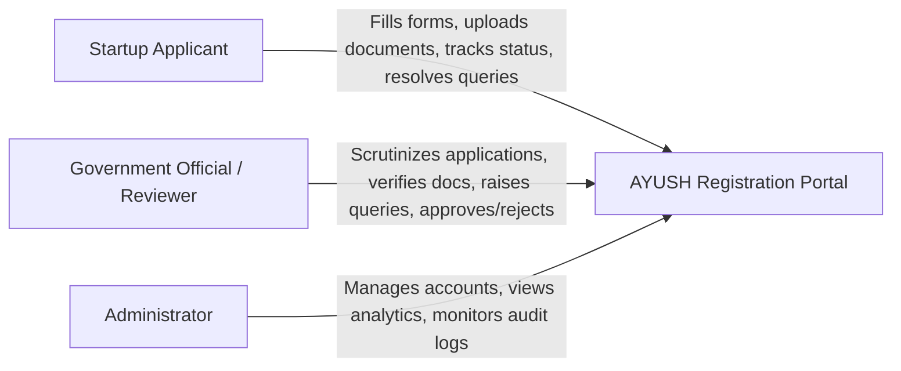
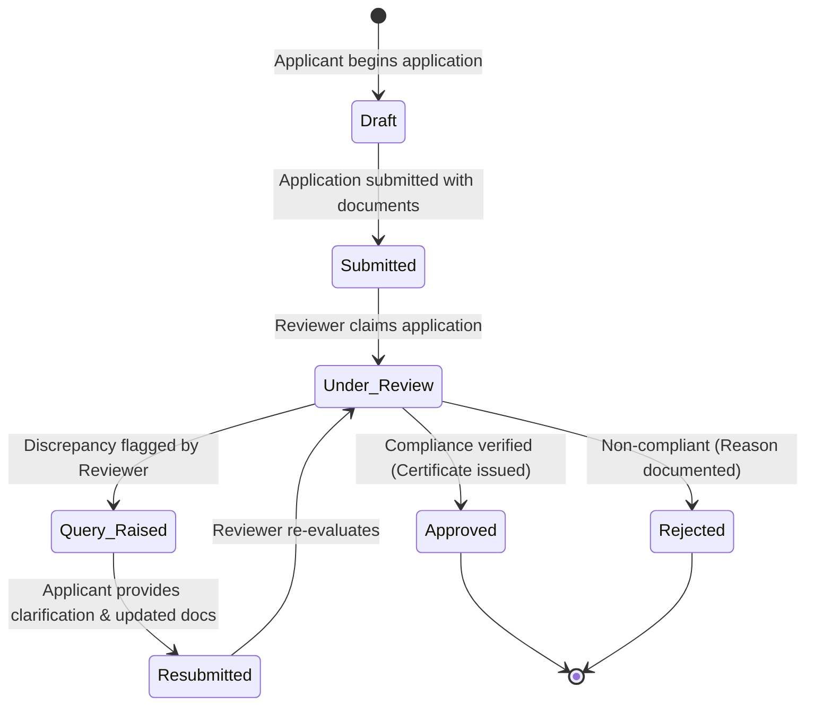

# AYUSH Startup Registration Portal

A comprehensive digital platform designed to streamline, digitize, and standardize the registration process for startups operating across the AYUSH sector (**A**yurveda, **Y**oga & Naturopathy, **U**nani, **S**iddha, and **H**omoeopathy).

Developed as part of the **Advanced Software Development (ASD)** and **Database Management Systems (DBMS)** curriculum, this portal addresses existing inefficiencies in traditional registration processes by enhancing transparency, accelerating regulatory reviews, and securing sensitive compliance documentation.

---

## 🏛️ Project Background & Problem Statement

* **Domain / Category**: MedTech / BioTech / HealthTech (Software)
* **Initiating Organization**: Ministry of AYUSH
* **Department**: All India Institute of Ayurveda (AIIA)

The AYUSH sector is experiencing rapid entrepreneurial growth with innovative formulations, wellness products, and digital healthcare solutions. However, startups often encounter challenges in navigating opaque, decentralized, and manual registration processes. 

The **AYUSH Startup Registration Portal** solves this by offering a centralized single-window system that connects **Startup Applicants**, **Government Officials / Reviewers**, and **System Administrators** in a transparent, accountable, and secure workflow.

---

## 📋 Project Documentation (Phase 1)

All Phase 1 requirement analysis, workflow definitions, and technical architectural specifications are detailed within the [`docs/`](./docs) directory:

| Document | Description |
| :--- | :--- |
| **[`docs/requirements.md`](./docs/requirements.md)** | Problem statement, functional requirements (FR-1 to FR-7), non-functional requirements (security, usability, scalability, reliability), and MVP boundaries. |
| **[`docs/user-roles.md`](./docs/user-roles.md)** | Detailed role specifications (*Startup Applicant*, *Government Reviewer*, *Administrator*), Role-Based Access Control (RBAC) matrix, and Mermaid Use-Case diagram. |
| **[`docs/application-workflow.md`](./docs/application-workflow.md)** | Complete end-to-end registration lifecycle, state transition machine (`Draft` $\rightarrow$ `Submitted` $\rightarrow$ `Under Review` $\rightarrow$ `Query Raised` $\rightarrow$ `Resubmitted` $\rightarrow$ `Approved` / `Rejected`), and Mermaid workflow flowchart. |
| **[`docs/tech-stack.md`](./docs/tech-stack.md)** | Project stack: Vite, React, JavaScript, Express, PostgreSQL, and Prisma. |
| **[`docs/architecture.md`](./docs/architecture.md)** | High-level 3-tier system architecture, component interactions, security model, and Mermaid architecture & sequence diagrams. |

---

## 👥 User Roles at a Glance



---

## 🔄 Core Application Workflow



---

## 💻 Technology Stack

* **Frontend**: Vite, React, JavaScript, Tailwind CSS, Lucide Icons
* **Backend**: Node.js, Express, JavaScript (CommonJS), REST API
* **Database & ORM**: PostgreSQL and Prisma ORM
* **Authentication & Security**: To be implemented; server-side role checks and password hashing are required
* **Document Storage**: Secure local/cloud storage with signed access URLs
* **Documentation & Diagrams**: Markdown with native GitHub-rendered Mermaid.js diagrams

---

## 🚀 Repository Structure

```text
AYUSH-Startup-Registration-Portal/
├── frontend/
├── backend/
├── README.md
└── docs/
    ├── requirements.md
    ├── user-roles.md
    ├── application-workflow.md
    ├── tech-stack.md
    └── architecture.md
```

---

## 📅 Roadmap

- [x] **Phase 1: Requirement Analysis & Project Documentation**
  - Problem statement analysis & scope definition
  - Stakeholder role definitions & RBAC permissions matrix
  - Application lifecycle & query resolution workflow
  - Technology stack selection & architectural modeling
  - Visual Mermaid use-case, workflow, and architecture diagrams
- [ ] **Phase 2: Database Design & Backend Modeling**
  - Relational schema design (ER modeling & 3NF normalization)
  - Prisma schema definition (`schema.prisma`) & migrations
  - Seed scripts for default roles and master data
- [ ] **Phase 3: Core Implementation**
  - Authentication & session management
  - Multi-step application wizard & file uploads
  - Reviewer inbox, query management & adjudication
  - Certificate generation & status tracking
- [ ] **Phase 4: Testing, Auditing & Deployment**
  - Unit, integration, and security testing
  - Final demonstration & deployment

