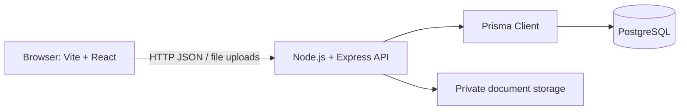

# System Architecture

The project uses a separate React frontend and Express backend. Both applications are written in JavaScript. The backend uses Prisma to access PostgreSQL.

## Responsibilities

### Frontend

The Vite and React application renders the public site and the startup, officer, and admin interfaces. It collects user input and calls the backend API. Frontend route guards support navigation but do not replace backend authorization.

### Backend

The Express application handles API requests, validates input, authenticates users, enforces role and ownership rules, applies application workflow rules, and coordinates database and document-storage operations.

### Database and files

PostgreSQL stores structured records. Prisma defines the data model, provides database access from JavaScript, and manages migrations. Uploaded files belong in private file storage; PostgreSQL stores their metadata and storage identifiers.

## Request flow

1. The browser sends an API request to Express.
2. Express authenticates the request and checks permissions.
3. The application logic validates the request and applies workflow rules.
4. Prisma reads or updates PostgreSQL, using a transaction for related critical updates.
5. Express returns a JSON response to the browser.

The portal may track application outcomes or portal recognition. It must not claim to issue statutory licenses or regulatory approvals that belong to an external authority.
